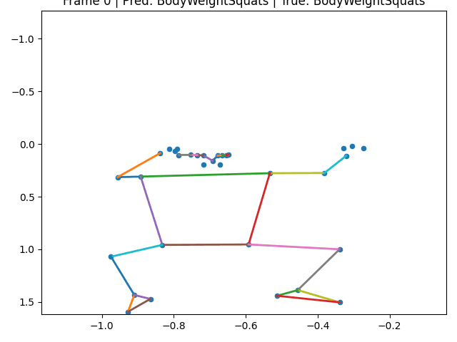

# 🎯 Motion Pattern Prediction using Transformer

This project focuses on **human motion pattern prediction** using pose estimation and a Transformer-based deep learning model.
It processes videos, extracts human keypoints using MediaPipe, and predicts motion classes.

---

## 📌 Features

* 🎥 Video-based motion analysis (UCF-101 dataset)
* 🧍 Pose estimation using MediaPipe
* 🤖 Transformer-based deep learning model
* 📊 Evaluation using confusion matrix & classification report
* 📈 Training visualization (accuracy/loss graphs)
* 🎬 Motion sequence visualization (skeleton animation)

---

## 📁 Project Structure

```
motion-pattern-prediction/
│
├── model.py                # Transformer model
├── train.py                # Training script
├── test.py                 # Testing script
├── evaluate.py             # Evaluation (confusion matrix, report)
├── visualize.py            # Skeleton animation
├── handledataset.py        # Dataset preprocessing
├── videcount.py            # Video utilities
├── filter.py               # Data filtering
│
├── requirements.txt
├── README.md
│
├── confusion_matrix.png
├── training_graph.png
│
└── (External via Drive)
    ├── UCF-101 dataset
    ├── Processed dataset (.npy)
    ├── Saved models (.pth)
```

---

## ⚙️ Requirements

* Python **3.10 **
* Install dependencies:

```
pip install -r requirements.txt
```

---

## 📦 Dataset and models

Project repository: [Rakesh's motion predictor](https://github.com/rakesh242-cloud/motion-predictor-deep-learning-model)

[Original project reference](https://github.com/kairo786/attention-based-Transformer-models-for-motion-pattern-analysis)

[Shared Drive folder](https://drive.google.com/drive/folders/1n7W1V5KksnHhLEg8NcDRZ1csSFvgXQJr?usp=sharing)

**Training, testing, evaluation, and visualization use the four processed `.npy` files directly from Google Drive by default.** Run the scripts normally after installing `requirements.txt`; `data_loader.py` transfers each array into memory and does not save it as a local dataset file. This transfers about 450 MB per run, so an internet connection and enough RAM are required. The 7.41 GB `UCF-101.zip` archive is not needed for these scripts. The pretrained `best_model.pth` is already included in this repository.

```powershell
python train.py
python evaluate.py
```

If you already have the four `.npy` files locally and want to use them instead, put them beside `train.py` and set `MOTION_DATA_SOURCE=local` in PowerShell:

```powershell
$env:MOTION_DATA_SOURCE = "local"
python train.py
```

The raw-video preprocessing scripts (`filter.py`, `handledataset.py`, and `videocount.py`) still need the extracted `UCF-101` videos. They look in the project folder by default. To use videos stored elsewhere, set `UCF101_DATASET_PATH`:

```powershell
$env:UCF101_DATASET_PATH = "C:\path\to\UCF-101"
python filter.py
```

`plot_accuracy.py` looks for `saved_models_93/modelaccuracy.log` in the project folder. Set `TRAINING_LOG_PATH` if your log is elsewhere.

---

## 🚀 How to Run

### 1️⃣ Dataset Preparation

If you want to regenerate dataset:

```
python handledataset.py
```

This will:

* Read videos from UCF-101
* Extract pose keypoints
* Save `.npy` files

---

### 2️⃣ Training

```
python train.py
```

Output:

* Saved model (`.pth`)
* Training graph (`training_graph.png`)

---

### 3️⃣ Testing

```
python test.py
```

---

### 4️⃣ Evaluation

```
python evaluate.py
```

Output:

* Confusion Matrix
* Classification Report

---

### 5️⃣ Visualization

```
python visualize.py
```

Shows:

* Skeleton motion animation from sequences
* 
---

## 🧠 Model Details

* Architecture: Transformer-based model (`MotionTransformer`)
* Input: Sequence of pose keypoints
* Output: Motion class prediction

---

## 📊 Results

* Accuracy: ~93%

* Confusion Matrix:

* Training Graph:

---

## ⚠️ Notes

* MediaPipe requires Python 3.10
* Large files are not included in the repo
* Use GPU (if available) for faster training

---

## 📌 Future Improvements

* Real-time prediction
* WebRTC integration

---

## 👨‍💻 Author

**Rakesh** ([rakesh242-cloud](https://github.com/rakesh242-cloud))
EP, IIT Patna

---

## ⭐ If you like this project

Give it a ⭐ on GitHub!
